# Robotic Load-Haul-Dumper (LHD)

Scaled system for mining automation technology development

TECHNICAL REPORT | 13 October 2026

Project inventors: Shobit Verma, Bryan Vas and Bhupendra Singh Rathore

IIT (ISM) Dhanbad

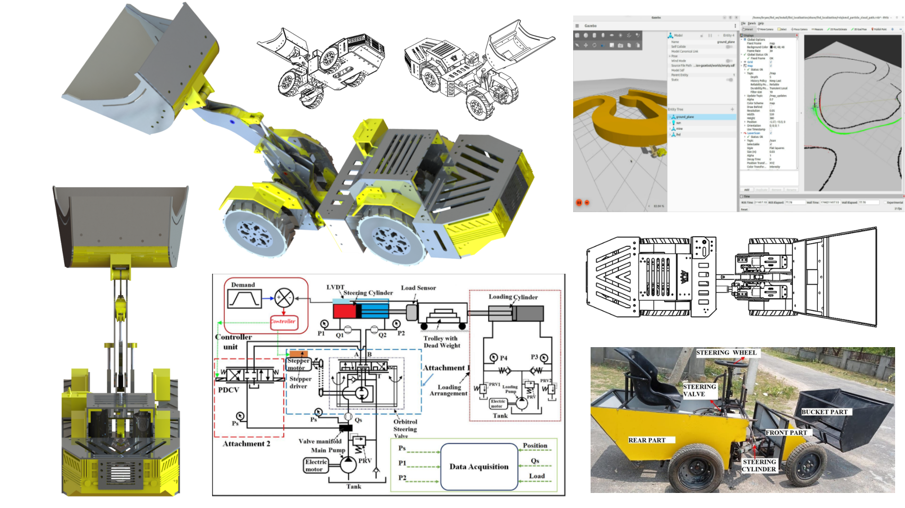

## Abstract

This report consolidates the supplied LHD presentations, mechanical drawings, bill of materials, control-system analysis and simulation demonstration into one engineering account. The platform uses a four-wheel, centre-articulated layout for laboratory investigation of underground loading and hauling. Its mechanical concept combines modular chassis construction with a front boom and bucket; the steering study uses instrumented hydraulic actuation. The autonomy architecture uses a ROS client-server arrangement, AMCL localisation, A* global planning and nonlinear model predictive control solved with CasADi.

The evidence comprises CAD designs, a photographed fabricated machine and static-map navigation in Gazebo/RViz. This report documents those results and the integration work needed to connect navigation to the physical platform. Quantitative tracking, payload, energy and endurance results are not supplied.

# 1. Project scope and evidence

## Engineering problem

An underground LHD collects broken material at a working face, transports it along a confined drive and deposits it at a tip or ore pass. This project brings that task into a laboratory setting that makes vehicle geometry, actuation and control accessible for experimentation. It aims to reduce operator exposure and investigate repeatable navigation without the costs and operating constraints of testing directly on a production machine. Fatigue, idle time and confined-space operation motivate the work [S1, pp. 2-5].

| Area | Evidence | Interpretation |
| --- | --- | --- |
| Mechanical concept | CAD and nine drawing views | Modular design and assembly geometry. |
| Fabrication | Labelled photograph | A physical LHD platform was fabricated. |
| Steering | Hydraulic circuit and control report | Instrumented actuation with a separate loading rig. |
| Navigation | Gazebo/RViz views and video | Localisation, planning and tracking in simulation. |
| Deployment | Future-work slide | Physical autonomy and dynamic obstacles remain development tasks. |

## Configuration boundaries

The materials describe related but not fully reconciled configurations. The modular CAD/BOM contains printed parts, electrical drivers and battery items; the presentation and control report describe hydraulic traction, lift and steering. This report treats CAD design, the fabricated hydraulic machine and navigation simulation as distinct evidence sets, rather than assuming every listed component was installed on the photographed machine [S1-S3].

## Report structure

Sections 2-5 describe mechanics, hydraulics and sensing. Sections 6-9 explain the navigation architecture and control. Sections 10-12 document operation, simulation and fabrication. Sections 13-15 preserve drawings, dimensions and costs. Section 16 proposes an integration and validation programme; Section 17 gives conclusions and sources.

# 2. Modular mechanical design

Two chassis halves meet at a central steering pivot, with four wheels and a front boom carrying the bucket. Load-handling equipment occupies the front; the rear accommodates power and control equipment. The drawings show a complete assembly with accessible mechanical interfaces [S1, pp. 13-14; S2; S4].

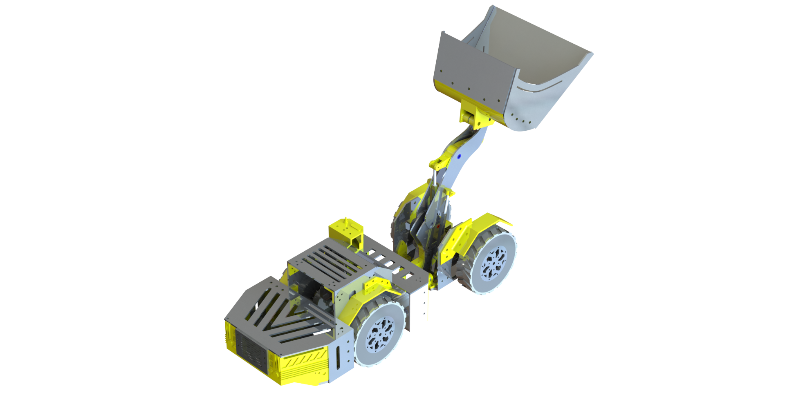

## Construction approach

The description proposes flat metal parts suited to CNC machining and wedges or connectors that can be made additively or conventionally. A connector, bracket or joint can therefore be revised without redesigning every adjacent component. Aluminium stock and multiple polymer materials appear in the original BOM, supporting the mixed manufacturing approach [S2, p. 12; S4].

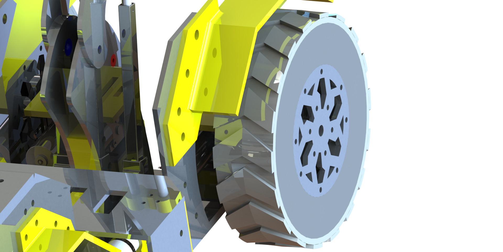
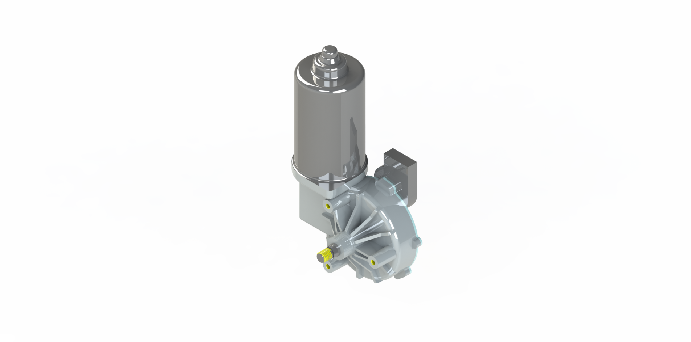
Figure 2. Running-gear/chassis detail and motor/drive rendering.

The renders establish component arrangement but do not specify bearing fits, fastener preload, fatigue life or permissible payload. Those parameters must be defined before the assembly can be treated as a qualified load-bearing design.

# 3. Articulation, boom and bucket

## Centre articulation

Steering changes the angle between the chassis halves about a vertical pivot. Opposed hydraulic cylinders act across this joint in the hydraulic configuration. The topology supports turning in confined drives, but the turning envelope depends on joint travel, front/rear geometry, tyre contact and boom clearance. A measured minimum turning radius cannot be derived from the images alone [S1, pp. 6-7; S3].

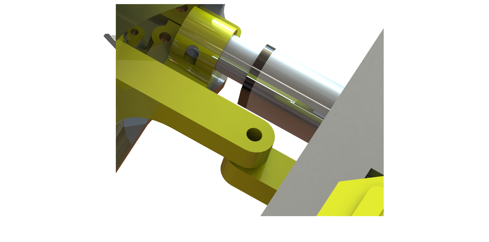
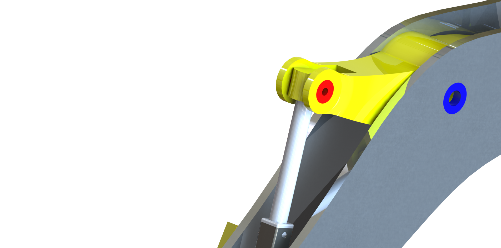
Figure 3. Actuator installation detail and boom-linkage pivot.

## Load handling

The boom supports collection, raising and discharge, while the bucket linkage controls orientation relative to the boom. Design requirements propose coordinated tilt, lift and dump actuation; the hydraulic presentation specifically identifies lift cylinders. The bucket tilt actuator and control sequence should be established for the selected build [S1, pp. 6, 13-16; S3-S4].

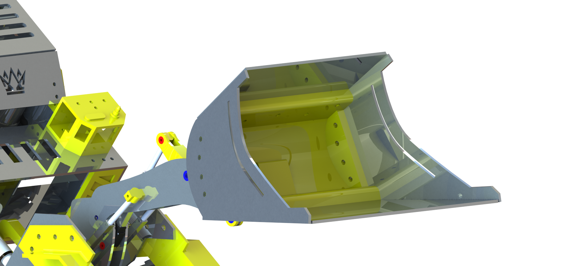

## Mechanical checks

For a defined payload and bucket position, chassis, articulation pin and boom checks should establish load transfer and stability. Cylinder travel must be mapped to joint angles, and end stops should prevent interference. These are proposed checks: the sources provide no payload test, stress result or measured linkage calibration.

# 4. Hydraulic steering architecture

The steering study uses an electric motor/pump, relief regulation and a manifold supplying the actuator. The main pump is described as supplying traction, lift and steering, but the original diagram details only the steering branch. Traction and lift circuits should not be inferred from it [S1, pp. 6-7; S3].

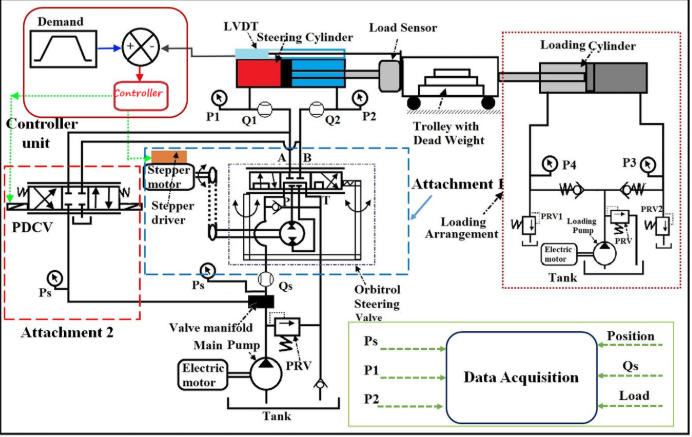

## Actuation arrangements

One path uses an Orbitrol valve with its input shaft driven by a stepper motor and driver. The second uses a proportional directional control valve commanded by the controller. The source labels these as attachments without establishing whether they operate simultaneously or as alternatives. Comparative experiments must document the active path, valve calibration and switching conditions.

## Loading rig

The separate pump circuit, loading cylinder, trolley, dead weight and load sensor apply external resistance during steering experiments. This is test apparatus rather than an assumed vehicle subsystem. It allows command, pressure, flow and actuator position to be observed under an imposed load.

## Feedback

The stepper command sets the valve input; the measured cylinder position reports the response. Feedback can correct residual error instead of relying solely on commanded steps. No tested loop gains, bandwidth or response-time values are supplied.

# 5. Sensing and state estimation

Navigation measurements and hydraulic experiment channels have different roles. Pressure, flow, position and load describe the actuator/test conditions; they do not replace a global pose estimate [S3, instrumentation; S1, p. 12].

| Measurement | Function | Source boundary |
| --- | --- | --- |
| Supply pressure Ps | Hydraulic supply state | Shown in circuit; no logged result. |
| Port pressures P1, P2 | Cylinder loading | No pressure-response dataset. |
| Flows Qs, Q1, Q2 | Available flow / motion | Acquisition timing not specified. |
| LVDT / rod position | Steering displacement feedback | Angle calibration required. |
| Load sensor | Resistance imposed by test rig | Not a vehicle payload test. |
| Loading pressures P3, P4 | Loading-circuit condition | Rig instrumentation. |
| LiDAR | Scans for map-based localisation | Navigation shown in simulation. |
| Odometry | Incremental motion estimate | Estimator details not supplied. |
| Camera / IMU | Listed sensors or objectives | Exact fusion/use not established. |
| DAQ | Collects experiment channels | Rate and synchronisation not stated. |

## Calibration and integration

Calibrate sensors independently, verify signs and units, time-stamp measurements and map actuator travel to articulation before coupling the interface to navigation. Positive rod extension should correspond to a defined articulation direction shared by the plant model. This avoids a numerically correct command producing opposite physical steering.

## Required specifications

Sensor ranges, update rates, uncertainty and transport delay are needed for controller tuning and interpretation. The source identifies channel roles but does not give these specifications. A reproducible experiment should store calibration and acquisition settings alongside the measured data.

# 6. ROS autonomy architecture

The architecture separates an LHD client node, LHD server node and path-planning service. Map/costmap, pose and target feed planning; the reference trajectory feeds tracking. Feedback returns to the client to monitor execution [S1, pp. 9-12; S3].

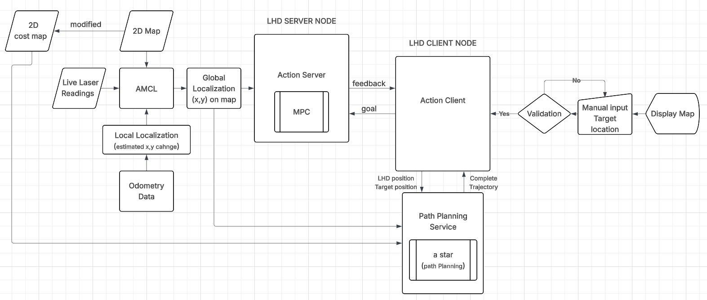

| Element | Responsibility |
| --- | --- |
| Map and costmap | Occupancy and traversal information. |
| Localisation | Estimate current pose from scans and odometry. |
| Goal validation | Reject invalid/non-traversable targets. |
| LHD client | Submit targets, request paths and receive feedback. |
| Planning service | Generate the A* reference path. |
| LHD server | Track the reference with MPC and produce outputs. |
| Feedback | Return execution state and progress. |

## Modularity

This separation helps distinguish invalid targets, planning failures and tracking deviations. Model and hardware-interface changes can be evaluated without rewriting the entire navigation system. The sources allow manual map goals and describe autonomous target-site selection; the demonstration establishes a submitted-goal traversal rather than a multi-stop autonomous work scheduler.

# 7. Localisation and global planning

## AMCL

AMCL combines laser observations and an odometry-based motion estimate against a known occupancy map. The RViz particle cloud represents localisation hypotheses. The supplied environment is static: this evidence does not establish autonomous map construction or robust navigation in changing mine conditions [S1, pp. 8, 11; S3].

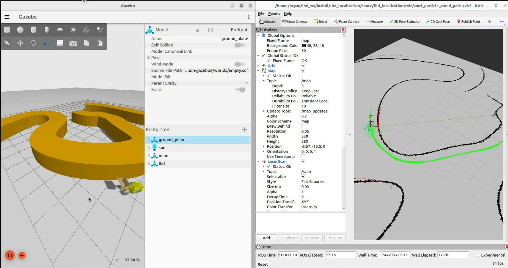

## A* on the costmap

The flowchart uses an open set, predecessor records and g/f scores. It explores eight-connected neighbours, checks map bounds, rejects impassable pixels and updates a record when a better tentative score is found. Back-tracing reconstructs the path from goal to start [S1, p. 10; S3].

Obstacle inflation provides clearance around occupied regions. An articulated vehicle requires a clearance choice based on its footprint and steering envelope, not just one reference point. Inflation distance, heuristic weighting and route-smoothing parameters are not supplied.

## Path feasibility

The route must reach the controller with consistent position, heading and timing conventions. Feasibility should be checked against articulation and speed limits before use on hardware. This is an integration requirement rather than a reported experimental result.

# 8. Original A* planning flowchart

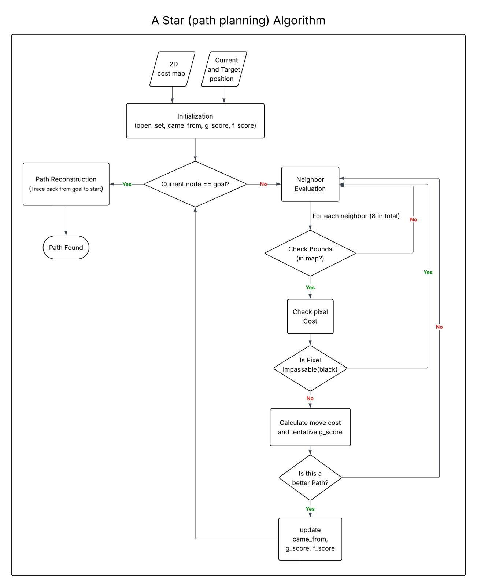

The original diagram preserves its branch conditions and variable names. It describes search and reconstruction, but does not report planning latency, path length, comparison with another planner or success rate across repeated trials [S1, p. 10].

Validation should use documented start/goal pairs on a fixed costmap, check collision clearance and feasible articulation, and retain settings and failed searches together with successful routes.

# 9. Model predictive control

MPC predicts future outputs using a plant model and compares them with the planned reference. A nonlinear optimisation problem, solved with CasADi, combines predicted error, an objective and constraints to produce future inputs. Receding-horizon operation applies the first input and repeats prediction using updated state information [S1, pp. 10-12; S3].

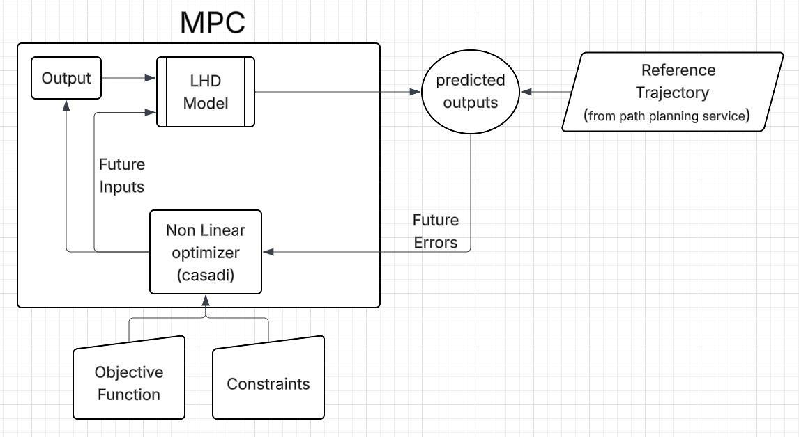

## Model and reference

The articulated vehicle model must use the same coordinate frame as localisation and planning. The source does not give the full equations, state vector, horizon, sample time or numerical weights, so those details cannot be reconstructed as implementation facts.

## Constraints and actuator interface

The diagram includes constraints without enumerating their implemented limits. Physical integration should define articulation, command rate, speed and cylinder travel bounds. In the stepper/Orbitrol arrangement, the output is translated into a valve-shaft command that meters flow and changes rod position. Calibration and feedback are required before a planned trajectory becomes a reliable physical command.

## Performance assessment

The evidence supports qualitative simulated tracking. A displayed path alone is not a tracking-error or robustness measurement. Quantification needs time-aligned reference and actual pose, command histories, solver timing and constraint activity.

# 10. Nominal operating sequence

This sequence consolidates the disclosed operation and flowcharts. Navigation is supported by simulation; load/dump stages describe the mechanical task and are not demonstrated autonomous bucket operation [S1, pp. 6-12, 18; S3].

| Stage | Operation | Feedback / condition |
| --- | --- | --- |
| 1. Power | Establish regulated hydraulic supply. | Pressure and permitted operating state. |
| 2. Localise | Update pose from scans and odometry. | Convergence against the prior map. |
| 3. Set target | Accept a manual or target-site request. | Goal in bounds and traversable. |
| 4. Plan | Search the costmap and reconstruct a route. | Available, footprint-feasible path. |
| 5. Track | Predict motion and solve the MPC problem. | Current state, reference and constraints. |
| 6. Actuate | Apply the first input through the actuator interface. | Command and travel limits. |
| 7. Correct | Measure response and advance the horizon. | Actuator and navigation feedback. |
| 8. Arrive | Determine goal completion. | Defined position/heading tolerance. |
| 9. Handle load | Position, raise and discharge the bucket. | Mechanism/task-specific logic. |
| 10. Stop / recover | Interrupt or return to a valid state. | Defined stop and communication-loss response. |

## Mission logic

A repeated loading-and-hauling mission also requires site selection, load state, bucket sequencing and recovery. Target-site generation is described as a planned capability, while the demonstration shows goal-directed navigation. Validating navigation first allows the work cycle to be added in separately testable stages.

## Fault handling

The presentation names emergency stopping and dynamic obstacle handling, with navigation extensions also listed as future work. The stopped state, valve behaviour after power loss and action cancellation response require specification and testing. No demonstrated fail-safe response is supplied.

# 11. Simulation evidence and results

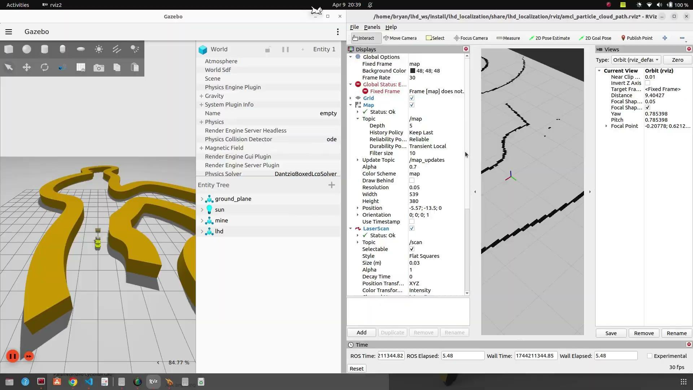

## Observed result

The supplied video and screenshots show a simulated LHD, mapped environment and navigation after a goal is supplied. The presentation identifies MPC trajectory following, localisation and planning; the control analysis specifies static-map Gazebo simulation [S1, pp. 8, 11, 18; S3; S5].

| Observation | Supported conclusion | Further evidence |
| --- | --- | --- |
| Vehicle and navigation views | Model and navigation share a simulation environment. | Model and sensor settings. |
| Displayed route / motion | A goal-directed planning/tracking demonstration exists. | Reference and actual pose logs. |
| Map and particle display | Localisation is represented in the workflow. | Pose error and convergence results. |
| Integration future-work statement | Physical autonomy remains a next step. | On-machine trials and logs. |

## Numerical results

No run count, tracking-error trace, success rate, solver timing, clearance measurement or energy log accompanies the demonstration. The result is therefore qualitative. This report does not invent performance plots from video frames: the original diagrams, map/path view and demonstration frame are the supplied graphical evidence.

Future evaluation should record position/heading error, articulation response, computation time and goal completion across repeated routes. These are proposed outputs, not measurements in the current source set.

# 12. Fabricated laboratory machine

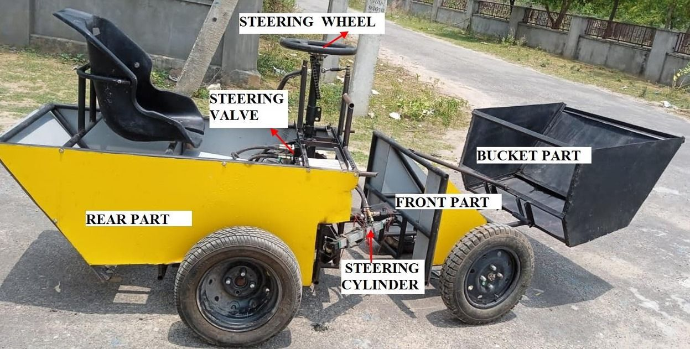

The photograph identifies rear and front sections, bucket, steering wheel, steering valve and steering cylinder. It directly establishes an assembled physical platform and major interfaces. Visible operator controls are consistent with use for mechanical and hydraulic development before navigation software is deployed [S1, p. 15].

## Physical integration

The central region joins the vehicle halves and supports steering actuation. The front carries the boom/bucket assembly; the rear provides the operator/equipment area. This arrangement allows the machine to support assembly inspection, steering experiments and load-handling development.

## CAD versus as-built record

The coloured CAD and BOM describe a modular concept; the photograph records the fabricated hydraulic platform. No parts reconciliation proves that every connector, electrical item or proposed actuator from the renders is installed on that machine. The CAD is consequently not treated as a complete as-built specification.

## Autonomy status

The presentation identifies integration of the algorithms into the working prototype as future work. The photograph demonstrates fabrication and the video demonstrates simulated navigation. Neither establishes autonomous underground operation or unattended loading on the physical vehicle [S1, p. 18; S3].

# 13. Original CAD drawing views

.png)
.png)
.png)
.png)
.png)
.png)
.png)
.png)
.png)

Figure 12. Nine original views, reproduced without trimming the assembly. The drawings document arrangement; they do not provide manufacturing tolerances, material grades or a verified structural assessment [S4].

# 14. Dimensions and configuration records

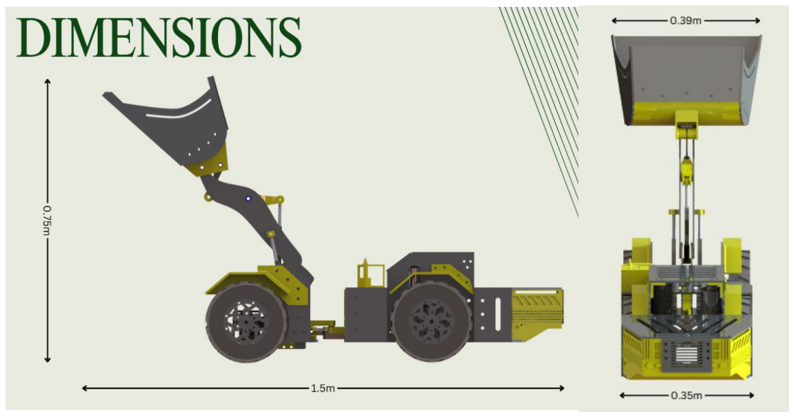

| Source | Record | Treatment |
| --- | --- | --- |
| Design / BOM presentation | 1.4 m and 0.75 m envelope dimensions. | Retained as this source's record. |
| Control analysis | 1.5 m length, 0.75 m height. | Retained as that report's description. |
| Main presentation | Original dimensioned assembly views. | Shown directly, not harmonised. |
| Design requirements | Coordinated tilt, lift and dump actuation. | Requirement; final actuators need reconciliation. |
| Hydraulic account | Traction, lift and steering branches. | Steering is detailed; other branches incomplete. |

## Configuration control

The dimension difference should be resolved against a selected CAD revision or as-built measurement, rather than by averaging. A controlled record should identify scale, wheelbase, articulation limits, bucket capacity, hydraulic hardware and installed electronics before reporting dimension-dependent calculations.

## Drawing scope

The dimensioned views support geometry inspection but do not state an approved payload, stability margin, tyre contact model or structural load case. Those are separate engineering inputs and cannot be inferred from the assembly image or certificate.

# 15. Bill of materials and source costs

Table 1 transcribes the original BOM Cost Table [S2, p. 12]. Quantities and costs are retained exactly; source entries without dimensions are marked accordingly.

| Part | Qty | Dimension / material | Unit cost | Line cost |
| --- | --- | --- | --- | --- |
| Aluminium plate | 1 | 500 x 500 x 8 mm | 33039 | 33039 |
| Aluminium plate | 1 | 300 x 300 x 8 mm | 9203 | 9203 |
| Aluminium plate | 3 | 500 x 500 x 5 mm | 21239 | 63717 |
| Aluminium plate | 6 | 300 x 300 x 5 mm | 2123 | 12738 |
| PLA yellow | 3 rolls | PLA | 849 | 2547 |
| PLA black | 2 rolls | PLA | 849 | 1698 |
| TPU black | 1 roll | TPU | 1999 | 1999 |
| ABS black | 1 | ABS | 1092 | 1092 |
| Arduino | 2 | Not specified | 207 | 414 |
| Breadboard power supply | 2 | Not specified | 91 | 182 |
| Power converter | 1 | Not specified | 129 | 129 |
| 2-pin screw terminal | 10 | Not specified | 46 | 460 |
| Solder wire | 1 | Not specified | 174 | 174 |
| Motor driver | 8 | Not specified | 250 | 2000 |
| Female connector | 1 | Not specified | 240 | 240 |
| RF module | 2 | Not specified | 138 | 276 |
| 16 AWG silicone wire | 20 | Not specified | 40 | 800 |
| Joystick | 2 | Not specified | 80 | 160 |
| 18650 battery | 3 | Not specified | 178 | 534 |

## Scope of the estimate

The table lists stock and selected electrical components. It does not include a complete hydraulic installation, Jetson computing assembly, LiDAR, fabrication labour or commissioning, and therefore is not the total cost of a complete autonomous hydraulic LHD.

The source gives no currency or quotation date. These are historical source values, not current quotations. Aluminium prices and stock quantities should be checked against the intended procurement scope before reuse.

A final BOM should connect purchased stock with drawings and operations, include consumables/spares, and preserve a consistent scope when comparing revisions.

# 16. Validation and development plan

This proposed programme turns the architecture into a measurable integrated experiment. It follows the evidence gaps and future-work slide, rather than asserting completed tests [S1, p. 18; S3].

| Stage | Test focus | Record |
| --- | --- | --- |
| Mechanical | Joint travel, clearance, alignment and boom motion. | As-built dimensions and interference checks. |
| Actuator calibration | Command, valve input, rod travel and joint angle. | Measured calibration and sign conventions. |
| Hydraulics | Steering under imposed resistance. | Pressure, flow, position and load histories. |
| Simulation | Repeat fixed start/goal cases. | Paths, pose, failures and timing. |
| Hardware interface | Bounded commands and feedback. | Command/response and communication delays. |
| Navigation integration | Controller on the physical platform. | Reference/actual routes and recovery events. |
| Mission extension | Load state, bucket sequence and site selection. | Transitions, handling motion and completion. |
| Environment extension | Dynamic obstacles and behaviour trees. | Detection, replanning and interruption results. |

## Measured performance

Report position and heading error over time together with reference route and sample rate. Planning/solver timing needs the selected computing hardware and settings. Steering results should show both commanded and actual articulation with the applied load. Use repeated runs, retain failed trials and avoid characterising performance from one successful video.

## Deployment

Scaled laboratory results alone do not establish production underground suitability. Payload, endurance, environmental tolerance and stopping behaviour need separately defined tests. The project provides a development platform from which those investigations can proceed.

# 17. Conclusions and source register

The project combines modular mechanical design, a fabricated centre-articulated machine, instrumented hydraulic steering and a ROS navigation architecture. The simulation supports the intended connection between AMCL, A* planning and MPC tracking. The supplied drawings, diagrams, costs and prototype photograph provide a development record.

The next milestone is to document the selected build, calibrate its actuator interface and evaluate navigation on hardware. Bucket automation, dynamic environments and repeatable missions require further implementation and measurements. This report preserves those boundaries while consolidating the source material.

| Ref. | Primary project source |
| --- | --- |
| S1 | LHD Presentation.pdf, 21 pages: concept, hydraulics, control diagrams, simulation, fabricated prototype and future work. |
| S2 | LHD design & BOM.pdf, 15 pages: models, dimensions and BOM Cost Table on page 12. |
| S3 | LHD Control System_DETAIL REPORT.docx, exported to the preserved 5-page control-system-source.pdf: configuration, sensors, software and operation. |
| S4 | DESCRIPTION_Robotic Load-Haul-Dumper (LHD) scaled system.docx; Design Requirement_LHD.docx; Photos folder: design requirements and CAD. |
| S5 | lhd_basic_autonomous_path_planning_and following-sped_up.mp4, linked on slide 11 of Presentation LHD.pptx: navigation demonstration. |
| S6 | UK design certificate 6552813.pdf: original certificate placed before this report in the combined PDF. |

## Source handling

Original figures are reproduced without invented measurements or synthetic performance plots. Project attribution follows the user-supplied inventor list; source documents and the certificate remain unchanged. Interpretations and proposed tests are distinguished from the supplied results.

Project files: https://drive.google.com/drive/folders/1mvUgHkXBSLNdLhBQV1PxxoK7y-DwFU-i

Certificate folder: https://drive.google.com/drive/folders/198TIlYKhwQuPtX5ge__tYrqXLF0Nnf9j
